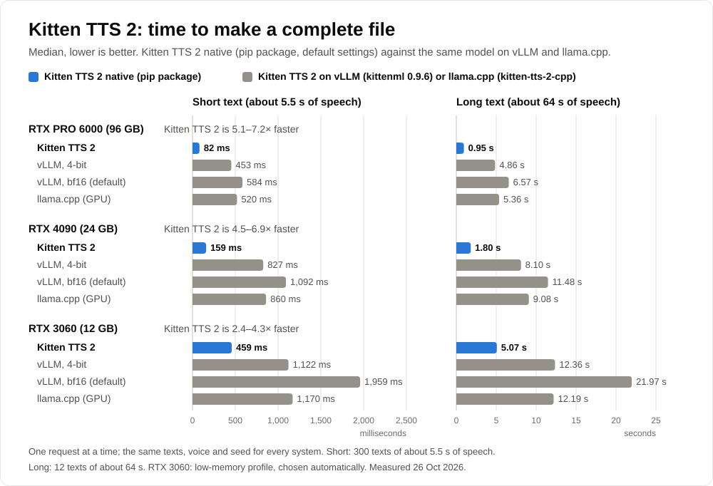
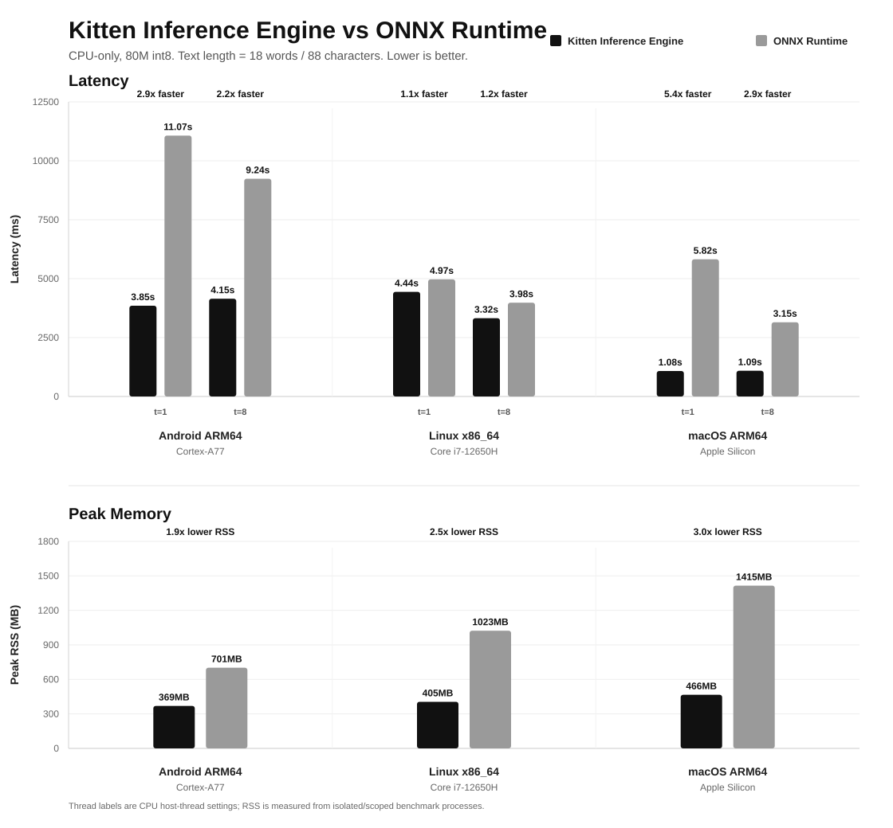

# kitten-inference

Fast native inference engines for the Kitten TTS text-to-speech models: Kitten TTS 2 on NVIDIA and AMD GPUs
([`engines/tts2/`](engines/tts2/)) and Kitten TTS 0.8 on the CPU ([`engines/tts08/`](engines/tts08/)). Install them with pip; no PyTorch needed.

|  | **Kitten TTS 2** on an NVIDIA GPU | **Kitten TTS 0.8** on the CPU |
|---|---|---|
| Headline | Complete files **5 to 7 times faster** than Kitten TTS 2 on vLLM or llama.cpp | The nano model **1.1 to 2.3 times faster** than kittenml 0.9.6 (ONNX Runtime) on Linux (x86-64 and ARM64), Windows x64 and Apple Silicon Macs |
| Speed | First streamed audio after **about 11 ms** (vLLM and llama.cpp: 481 to 643 ms, as they stream whole sentences) | **About 60 times faster than real time** |
| Example | A short text in 82 ms and a long text in 0.95 s, against 453 to 584 ms and 4.9 to 6.6 s on vLLM, 520 ms and 5.4 s on llama.cpp | A 41-word text (15 to 17 s of speech) in 0.29 s, against 0.54 s with ONNX Runtime |
| Measured on | RTX PRO 6000, one request at a time; vLLM through kittenml 0.9.6 | Ryzen 9 9900X (12 cores), default settings of both packages (on Apple Silicon this engine uses the GPU) |

On smaller GPUs the Kitten TTS 2 lead is smaller: first audio after 22 ms and complete files 4.5 to 6.9 times faster
on an RTX 4090, 58 ms and 2.4 to 4.3 times on a 12 GB RTX 3060. Word error rate on short texts is 0.02 to 0.05% for
every engine compared.





## Install

Both models use `from kitten_inference import KittenTTS` with an explicit model name ([API](docs/api.md)).

The commands below start a virtual environment and install support for both model families. On Ubuntu and Debian, `python3 -m venv` needs
`sudo apt-get update && sudo apt-get install -y python3-venv` first. On Windows, run the blocks in a Command Prompt (in PowerShell, type `cmd` first), with `py -m venv .venv` and then
`.venv\Scripts\activate.bat` in place of the first line.

### Kitten TTS 2: NVIDIA and AMD GPUs

```sh
python3 -m venv .venv && . .venv/bin/activate
python -m pip install -U pip
pip install "kitten-inference"
kitten-tts --model KittenML/kitten-tts-2 --text "Hello from Kitten TTS 2." --voice Bruno --output hello.wav
```

- NVIDIA GPU on Linux x86-64 (glibc 2.28 or newer: Ubuntu 20.04, Debian 10, RHEL 8 or later) or Windows x64, with driver R570 or newer.
- Python 3.9 to 3.14 (Python 3.15 needs a C compiler until PyYAML, a dependency, ships ready-made 3.15 packages).
  First use downloads the model (about 4.6 GB) and prepares it once, in about 1 to 3 minutes; later starts reuse it.
- **AMD Radeon RX 7000 and RX 9000:** supported inside WSL2 on Windows 11, experimental on Linux x86-64 without WSL2.
  Install ROCm 7 first (WSL2: step 1 of [AMD Radeon](engines/tts2/docs/amd-radeon.md); Linux without WSL2:
  [AMD's ROCm guide](https://rocm.docs.amd.com/projects/install-on-linux/en/latest/) for your distribution), then
  run the same commands: the package finds the Radeon (on a PC that also has an NVIDIA GPU, add `--backend rocm`).
  Real-time factor about 0.06 on an RX 9070 XT (10 s of speech in about 0.6 s). No voice cloning on Radeon.
- **Voice cloning** (NVIDIA only) needs FFmpeg (`sudo apt-get update && sudo apt-get install -y ffmpeg`; on Windows
  `winget install --id Gyan.FFmpeg -e`, then open a new Command Prompt and activate the venv again; Windows Server
  2022 needs winget installed first) and about 11,300 MiB (11 GB) of free GPU memory while the voice is built: on a
  12 GB card, other programs may use at most about 500 MiB.
- **GeForce GTX 10, GTX 16 and RTX 20 series:** supported, not optimal: they have no bf16 tensor cores, so part of the
  math runs in software (real-time factor 0.22 to 0.37 for complete files on desktop cards with 6 GB or more, against
  0.05 to 0.08 on RTX 30, 40 and 50 series cards).
- **Without Python:** the engine is also a C library and the `kitten-tts-native` command. Build it with
  `git clone --branch v0.2.0 https://github.com/KittenML/kitten-inference.git`, then `cd kitten-inference/engines/tts2`, and
  follow [engines/tts2/README.md](engines/tts2/README.md).

The package picks its memory settings from the free GPU memory ([GPU memory](engines/tts2/docs/memory.md)):

| GPU memory | Built-in voices | Voice cloning |
|---|---|---|
| 24 GB or more | default profile: about 13,500 MiB with one voice | yes: about 15,600 MiB while a voice is built |
| 16 GB | default profile when it fits, else the low-memory profile | yes, with the low-memory profile: about 11,300 MiB |
| 12 GB | low-memory profile, about 9,100 MiB: supported, not optimal, because requests at the same time share smaller buffers (one at a time runs as fast: real-time factor 0.050 against 0.051 on a 16 GB card) | only with about 11,300 MiB free; 10 GB cards: no |
| 4 to 8 GB | low-memory profile fitted to the card: supported, not optimal (one request at a time; complete files about 1.5% slower) | no: build and save the voice on a larger GPU, then load it |

### Kitten TTS 0.8: the CPU

```sh
python3 -m venv .venv && . .venv/bin/activate
python -m pip install -U pip
pip install "kitten-inference"
python -c "from kitten_inference import KittenTTS; KittenTTS('KittenML/kitten-tts-nano-0.8').generate_to_file('Hello from Kitten TTS.', 'hello.wav', voice='Jasper')"
```

- Supported: Python 3.8 to 3.14 on Linux x86-64 and ARM64, Windows x64 and Apple Silicon Macs (Python 3.15 needs a C
  compiler until PyYAML ships ready-made 3.15 packages). Experimental: Intel Macs (the macOS build uses one CPU core),
  Windows ARM64 (no ARM vector kernels, about 9 times slower than Linux ARM64) and Android ARM64
  ([platforms](engines/tts08/README.md#platforms)).
- On Windows, if `KittenTTS()` reports "espeak not installed", install the Microsoft Visual C++ Redistributable:
  `winget install Microsoft.VCRedist.2015+.x64`.
- On Windows, keep the virtual environment's path under about 150 characters; longer paths stop TTS 0.8 with an error
  that says so.
- **Supported, not optimal:**
  - int8 models on Intel CPUs: the int8 kernels for x86 are not tuned yet, so they take 1.2 to 2.2 times the ONNX
    Runtime time;
  - int8 models on Apple Silicon: the macOS build uses one CPU core, so they take 1.4 to 1.8 times the ONNX Runtime
    time;
  - creating a model again on the Mac GPU (Metal): each new `KittenTTS` keeps about 290 MB (nano) to 470 MB (mini)
    until the process ends, because the engine does not free its GPU copies of the weights yet. Create each model
    once and reuse it.

Both engines in one environment: `pip install "kitten-inference"` (Linux x86-64 and Windows x64,
Python 3.9 to 3.14).

## Use from Python

```python
from kitten_inference import KittenTTS

tts = KittenTTS("KittenML/kitten-tts-2")
tts.save_wav("hello.wav", tts.generate("Hello from Kitten TTS 2.", voice="Bruno"))
for chunk in tts.stream("Streaming speech, chunk by chunk.", voice="Bruno"):
    ...
```

```python
from kitten_inference import KittenTTS

KittenTTS("KittenML/kitten-tts-nano-0.8").generate_to_file("Hello from Kitten TTS.", "hello.wav", voice="Jasper")
```

## Docs

- [Unified Python API and `kitten-tts` command](docs/api.md): voices, streaming, voice
  cloning, saved voices, caches, and when the same seed gives the same audio.
- [Kitten TTS 2 engine](engines/tts2/README.md): speed tables, [supported GPUs](engines/tts2/README.md#supported-gpus), building
  from source, the command-line tool and the C API. Also: [Windows](engines/tts2/docs/windows.md),
  [AMD Radeon](engines/tts2/docs/amd-radeon.md), [GPU memory](engines/tts2/docs/memory.md),
  [speed and audio by GPU group](engines/tts2/docs/consumer-gpus.md).
- [Kitten TTS 0.8](engines/tts08/README.md): models and voices, options, platforms, and upgrading from 0.1.x
  (`import model_inference` needs `kitten-inference==0.1.1`).

## License

KittenML's code is Apache-2.0 ([LICENSE](LICENSE)); the package also contains third-party code under other licences
([NOTICE](NOTICE), [engines/tts2/NOTICE](engines/tts2/NOTICE), [engines/tts08/NOTICE](engines/tts08/NOTICE)). The models download on first use and keep their publishers' licences. The Kitten TTS 2 model is
under the [Stellon Labs Community License](https://huggingface.co/KittenML/kitten-tts-2/blob/main/LICENSE.md), not
Apache or MIT: it limits commercial use, training on the outputs and redistribution, so read it before you build on
Kitten TTS 2. The Kitten TTS 0.8 model licences are in [engines/tts08/README.md](engines/tts08/README.md#license).
